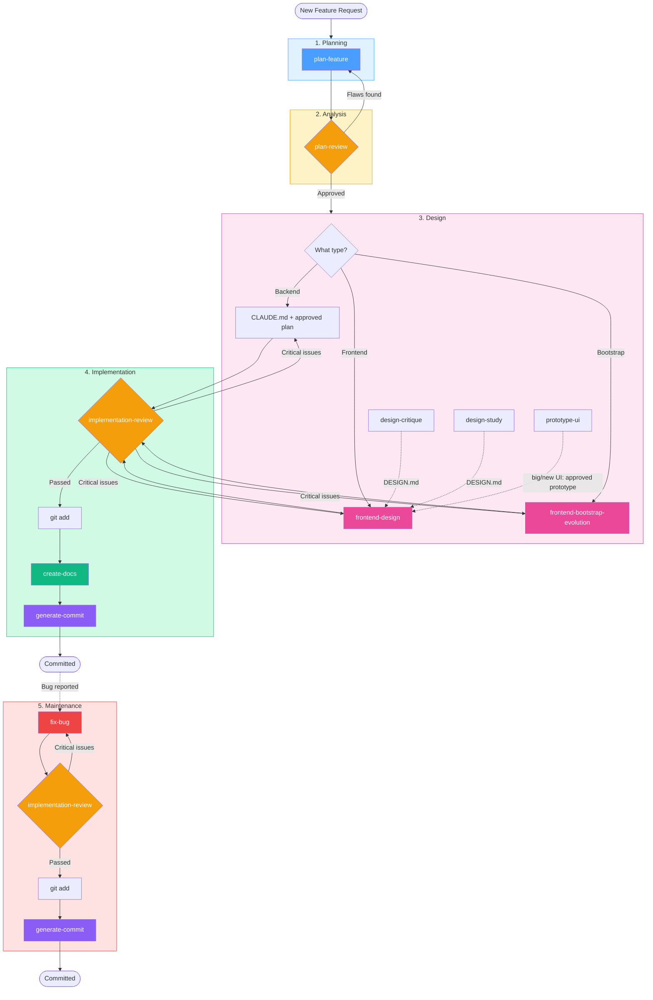

# Coding Agent Skills

A collection of coding agent skills and guidelines for feature development, direct tasks, and investigation. Includes delegation workflows for Codex, Claude Code, Antigravity, and pi.

## Structure

```
coding-agent-skills/
├── CLAUDE.md                          # Coding behavior guidelines
├── CLAUDE-template.md                 # Project-specific CLAUDE.md skeleton
├── skills/
│   ├── scaffold-project/              # Scaffold a new Flask + Bootstrap 5 + MongoDB project
│   │   ├── SKILL.md                   #   (assets/ = canonical starter files, scaffold.sh = assembler)
│   │   ├── scaffold.sh
│   │   └── assets/
│   ├── convert-to-house-style/SKILL.md # Migrate an existing project (reuses scaffold-project/assets)
│   ├── scaffold-electron-desktop/     # Scaffold a new Electron desktop app (electron-vite + React 19)
│   │   ├── SKILL.md                   #   single-app layout with enforced UI-free src/main/core/
│   │   ├── scaffold.sh
│   │   └── assets/
│   ├── add-capability/                # Bolt a house-style capability onto a project (dispatcher)
│   │   ├── SKILL.md                   #   routes by name: auth · seo · storage · i18n · payment
│   │   └── capabilities/             #   one instruction file per capability
│   │       ├── auth.md  seo.md  storage.md  i18n.md  payment.md
│   ├── plan-feature/SKILL.md             # Create implementation plans
│   ├── plan-review/SKILL.md          # Review and iterate on plans
│   ├── implementation-review/SKILL.md # Review code for bugs and flaws
│   ├── orchestrate-implementation-pi/    # Same loop, implementor is the pi CLI
│   │   ├── SKILL.md                   #   fresh pi session per phase, back-and-forth via resume,
│   │   │                              #   stops at review (no docs, no commits)
│   │   ├── pi-rpc.sh                  #   helper to start, resume, compact, and stop one session per phase
│   │   └── references/                #   pi CLI reference and worker troubleshooting
│   ├── orchestrate-implementation-claude/ # Same loop, pure Claude Code, no external CLI
│   │   ├── SKILL.md                   #   fresh phase-implementor subagent per phase, SendMessage for
│   │   │                              #   questions, stops at review (no docs, no commits)
│   │   └── agents/
│   │       └── phase-implementor.md   #   sonnet subagent, copy to ~/.claude/agents/ to install
│   ├── orchestrate-implementation-codex/ # Same loop, implementor is the Codex CLI (codex exec)
│   │   ├── SKILL.md                   #   fresh Codex thread per phase, back-and-forth via resume,
│   │   │                              #   stops at review (sandbox keeps .git read-only, no commits)
│   │   └── codex-exec.sh              #   helper to start, resume, and stop one thread per phase
│   ├── orchestrate-implementation-agy/   # Same loop, implementor is the Antigravity CLI (agy)
│   │   ├── SKILL.md                   #   fresh agy conversation per phase, back-and-forth via resume,
│   │   │                              #   stops at review (no docs, no commits)
│   │   ├── agy-exec.sh                #   helper to start, resume, and stop one conversation per phase
│   │   ├── check.sh                   #   runnable check
│   │   └── references/                #   agy CLI reference, subagents, and troubleshooting
│   ├── delegate-work-codex/          # Delegate tasks or discussion from a request, no plans/ dependency
│   │   ├── SKILL.md                   #   task brief, same-thread discussion, independent review, no commits
│   │   └── codex-exec.sh              #   standalone helper, one thread per bounded assignment
│   ├── delegate-work-agy/            # Same loop, delegate tasks directly using Antigravity CLI (agy)
│   │   ├── SKILL.md                   #   task brief, same-conversation replies, independent review, no commits
│   │   ├── agy-exec.sh                #   standalone helper, one conversation per bounded assignment
│   │   ├── check.sh                   #   runnable check
│   │   ├── references/                #   agy CLI reference, subagents, and troubleshooting
│   │   └── tests/                     #   mocked helper checks, runnable without the agy CLI
│   ├── delegate-work-pi/             # Same loop, delegate tasks directly using the pi CLI
│   │   ├── SKILL.md                   #   task brief, same-session replies, independent review, no commits
│   │   ├── pi-work.sh                 #   standalone helper, one session per bounded assignment
│   │   ├── references/                #   pi CLI reference and worker troubleshooting
│   │   └── tests/                     #   mocked helper checks, runnable without the pi CLI
│   ├── delegate-work-claude/         # Delegate direct tasks or discussion to Claude subagents
│   │   ├── SKILL.md                   #   one subagent per assignment, same-thread discussion, no commits
│   │   └── agents/                    #   task-worker subagent definition
│   ├── delegate-work-swarm/          # Split a direct task across Codex, agy, and pi, run in parallel
│   │   ├── SKILL.md                   #   routes by task level and agent ranking, waves, independent review, no commits
│   │   ├── swarm-files.sh             #   snapshot, attribute, overlap, and restore file ownership in a shared Git tree
│   │   ├── references/swarm-rules.md  #   routing, pi model ranks, escalation, unavailability, drift (shared)
│   │   └── tests/                     #   helper checks against throwaway Git repos, no agent CLI needed
│   ├── orchestrate-implementation-swarm/ # Same swarm, phase by phase over an approved plan
│   │   └── SKILL.md                   #   milestones in a phase run in parallel waves, phase review, CTO report
│   ├── run-expo-android/             # Build an Expo app, run it on an Android emulator, drive it by text and screenshots
│   │   ├── SKILL.md                   #   Linux x86_64 and macOS (Apple Silicon or Intel), no sudo
│   │   └── scripts/                   #   setup, emulator, build, metro, tap, shot, fields, crash
│   ├── create-docs/SKILL.md          # Generate feature documentation
│   ├── generate-commit/SKILL.md      # Generate conventional commit messages
│   ├── document-and-commit/SKILL.md  # Document + stage + commit in one step (combines the two above)
│   ├── fix-bug/SKILL.md             # Diagnose and fix bugs (reproduce-first)
│   ├── design-critique/SKILL.md      # Critique a UI for its domain & audience, explore styles, redesign → DESIGN.md
│   ├── design-study/                 # Measure an existing site, app or screenshots → token sheet → DESIGN.md
│   │   ├── SKILL.md
│   │   ├── scripts/                   #   study_site.py: screenshots + computed-style tally (Playwright)
│   │   └── tests/                     #   runnable check against a local fixture page
│   ├── prototype-ui/SKILL.md         # Wireframes + clickable prototype with design rationale → approval (big/new UI only)
│   ├── frontend-design/              # Build UI: directly for simple additions, to the approved prototype otherwise
│   │   ├── SKILL.md
│   │   └── references/                #   design rules, domain & audience playbook, DESIGN.md template (shared)
│   ├── python-development/SKILL.md   # Production-grade Python: functional, imports at top, PEP 8
│   └── frontend-bootstrap-evolution/  # Bootstrap 5 frontend skill
```

## Workflow

The skills follow the SDLC phases:



| SDLC Phase | Skill | What it does |
|------------|-------|-------------|
| **1. Planning** | `plan-feature` | Creates a focused implementation plan in `plans/` |
| **2. Analysis** | `plan-review` | Reviews the plan for flaws, over-engineering, feasibility. Run multiple times — each pass logs changes to the plan file |
| **3. Design** | `design-study` / `design-critique` / `prototype-ui` / `frontend-design` / `frontend-bootstrap-evolution` / `python-development` | `frontend-design` builds UI: simple additions directly, big or new UI after an optional `prototype-ui` pass (wireframes and a clickable prototype with a design-decisions table, approved by you). `design-critique` critiques an existing UI for its domain and audience, explores styles with you, and writes `DESIGN.md`, which the other two follow. `design-study` measures an existing site, app or screenshots and writes `DESIGN.md` from it. `python-development` for Python. A phase can need both. Other backend work follows CLAUDE.md guidelines directly |
| **4. Implementation** | `orchestrate-implementation-claude` (or `orchestrate-implementation-agy` for agy, `orchestrate-implementation-codex` for Codex, `orchestrate-implementation-pi` for pi) → `implementation-review` → `document-and-commit` | Delegate phased implementation to an implementor, then review. The `-claude` variant spawns a fresh sonnet `phase-implementor` subagent per phase, needs no external CLI, and stops at review: it never commits, so the whole run is left uncommitted and you call `document-and-commit` yourself at the end. The `-agy` variant runs the same loop with the Antigravity CLI (agy): one fresh conversation per phase, back-and-forth exchanges through `agy-exec.sh resume`, and stops at review leaving work uncommitted. The `-codex` variant runs the same loop with the Codex CLI: one `codex exec` thread per phase, questions and replies go back and forth through `codex exec resume`, and the `workspace-write` sandbox keeps `.git` read-only so nothing is committed. The pi variant runs the same loop with the pi CLI: one fresh session per phase, back-and-forth exchanges through `pi-rpc.sh resume`, and stops at review leaving work uncommitted. For an Expo app, the review runs the app on an emulator with `run-expo-android`. `document-and-commit` combines `create-docs` and `generate-commit` |
| **5. Maintenance** | `fix-bug` | Reproduce-first bug fixing. Skips phases 1-3 |

## Delegating work and discussion

Use `delegate-work-codex`, `delegate-work-agy`, `delegate-work-pi`, or `delegate-work-claude`
for a direct task without a `plans/` folder or plan file. These skills support fixes,
refactors, investigations, and requested document edits. The main session owns scope, questions,
review, and verification. Changes remain uncommitted.

Use `orchestrate-implementation-<agent>` to implement an existing approved plan by phase.
For each agent, the plan gate runs before dispatch or project changes. If no readable approved
plan is available, it stops that workflow and recommends `delegate-work-<agent>`.
An unrelated `plans/` folder does not select plan implementation.

Use `delegate-work-swarm` to split a direct task across Codex, agy, and pi at the same time,
or `orchestrate-implementation-swarm` to do the same for an approved plan, phase by phase.
Each assignment goes to an agent by task level and your ranking (Codex > agy >= pi, with
pi's place set by the model it runs). Parallel workers own disjoint files in one Git tree,
and `swarm-files.sh` checks who changed what. See
[swarm rules](skills/delegate-work-swarm/references/swarm-rules.md).

The direct task skills also explicitly support discussion with a worker. The orchestrator
can ask for a second opinion, challenge assumptions, and resume the same thread or session
for follow-up questions. Discussion defaults to no product edits and does not authorize
implementation.

Example invocation:

```text
Use $delegate-work-agy to fix the search pagination bug. Preserve the existing API
and verify the affected flow. Do not commit.

Use $delegate-work-agy to discuss whether this architecture handles worker crashes.
Compare alternatives and challenge assumptions. Do not implement changes.

Use $delegate-work-codex to discuss this design with Codex. Challenge its assumptions
and compare alternatives. Do not implement changes.

Use $orchestrate-implementation-agy to implement the approved plan at
plans/search-pagination.md. Do not commit.

Use $orchestrate-implementation-codex to implement the approved plan at
plans/search-pagination.md. Do not commit.
```

Exact invocation syntax depends on the host and requires the skill to be available there.
Plain-language routing depends on the requested work. "Delegate implementation based on
this approved plan" fits plan implementation; "discuss this plan" fits discussion.

The Codex skills require a checkpoint and blocked report when the worker observes a
context-pressure warning. The orchestrator decides whether to request manual compaction
through a supported mechanism. Automatic runtime compaction can still occur. The current
Codex helpers capture usage events but expose no manual compaction command and do not
aggregate token totals. At the checked release, usage events carry thread-total snapshots.
Preserve the latest reliable total per thread instead of summing snapshots across resumes.

pi is the one agent here with a verified manual compaction mechanism: the helpers send
`{"type":"compact"}` over the RPC session, with optional custom instructions, and the worker
reloads the handoff records afterwards. Automatic compaction still fires near the context
limit before any warning, so a prompt instruction gives no veto over it.

The Codex CLI help baseline is `codex-cli 0.162.1`, checked on 2026-10-11. Both helpers
record the actual CLI version and command path for each turn so failures can be traced
to the installed release. Version differences prompt a help check, without automatic
upgrades or downgrades.

The same release was confirmed as latest stable on 2026-10-11. See the
[Codex maintenance record](skills/delegate-work-codex/references/codex-cli-reference.md#maintenance-review-2026-10-11)
for official release sources, help checks, mocked checks, and unverified live behavior.

The Antigravity CLI help baseline is `1.3.3`, checked on 2026-10-11. Both helpers
record the actual CLI version and command path for each turn under temporary helper state.
Copy them into the work log or implementation log. Version differences prompt a help check
against installed `agy --help` without automatic upgrades or downgrades.

The pi CLI help baseline is `0.85.1`, checked on 2026-10-11 at `/opt/homebrew/bin/pi`. Both
helpers record the actual CLI version and command path for each executed turn under
temporary helper state, and a failed version capture stops the turn instead of dispatching
the worker. Copy them into the work log or implementation log before another turn overwrites
them or `stop` removes them. Version differences prompt a help check against installed
`pi --help` without automatic upgrades or downgrades.

See the [delegation guide](docs/delegation.md) for current agent differences, handoffs,
compaction, token reporting, and troubleshooting. Use the
[skill creation prompt](docs/delegation-skill-creation-prompt.md) to create missing variants
or update outdated ones against the Codex baseline.

## CLAUDE.md

The `CLAUDE.md` file provides behavioral guidelines that apply across all steps:

1. **Think Before Coding** — surface assumptions, ask when unclear
2. **Plan for Delivery, Not Perfection** — scope tight, ship small
3. **Simplicity First** — minimum code, nothing speculative
4. **Surgical Changes** — touch only what you must
5. **Goal-Driven Execution** — define success criteria, loop until verified

## Installation

Pick the instructions for your tool:

### Antigravity (agy CLI and IDE)

```bash
# 1. Global behavioral guidelines (applied to every project)
mkdir -p ~/.gemini/config
cp CLAUDE.md ~/.gemini/config/AGENTS.md

# 2. Global skills (available in every project)
mkdir -p ~/.gemini/config/skills
for dir in skills/*/; do ln -s "$(realpath "$dir")" ~/.gemini/config/skills/; done

# 3. Per-project config (fill in the template)
cp CLAUDE-template.md /path/to/your-project/AGENTS.md
```

Skills auto-discover at startup. Or configure paths:
- Context file: `~/.gemini/config/AGENTS.md` (or `GEMINI.md`)
- Global skills: `~/.gemini/config/skills/<skill-name>/`
- Project skills: `.agents/skills/<skill-name>/` (or `.gemini/skills/`)

### pi

```bash
# 1. Global behavioral guidelines (applied to every project)
mkdir -p ~/.pi/agent
cp CLAUDE.md ~/.pi/agent/AGENTS.md

# 2. Global skills (available in every project)
mkdir -p ~/.pi/agent/skills
for dir in skills/*/; do ln -s "$(realpath "$dir")" ~/.pi/agent/skills/; done

# 3. Per-project config (fill in the template)
cp CLAUDE-template.md /path/to/your-project/CLAUDE.md
```

Skills auto-discover at next pi startup. Or symlink manually:
- Context file: `~/.pi/agent/AGENTS.md`
- Skills: `~/.pi/agent/skills/<skill-name>/`
- Project skills: `.pi/skills/<skill-name>/`

### Claude Code

```bash
# Copy all skills
cp -r skills/* /path/to/your-project/.claude/skills/

# Or copy specific skills only
cp -r skills/plan-feature /path/to/your-project/.claude/skills/
cp -r skills/fix-bug /path/to/your-project/.claude/skills/

# Behavioral guidelines → .claude/CLAUDE.md
cp CLAUDE.md /path/to/your-project/.claude/CLAUDE.md

# Project-specific config → root CLAUDE.md (fill in the template)
cp CLAUDE-template.md /path/to/your-project/CLAUDE.md
```

### File Placement by Tool

Different AI coding tools use different file names and locations. The content is the same — only the file name and path differ.

#### pi

Reference: [Pi docs](https://github.com/badlogic/pi-skills)

```
your-project/
├── CLAUDE.md                    # Project-specific (from CLAUDE-template.md)
└── .pi/
    └── skills/                  # Skills copied or symlinked here
```

pi loads **context files** (`CLAUDE.md` or `AGENTS.md`) from the current directory and walks up the tree. For global instructions that apply to every project:

```bash
# Global behavioral guidelines (~/.pi/agent/AGENTS.md)
mkdir -p ~/.pi/agent
cp CLAUDE.md ~/.pi/agent/AGENTS.md

# Global skills (~/.pi/agent/skills/)
mkdir -p ~/.pi/agent/skills
cp -r skills/* ~/.pi/agent/skills/
# Or symlink to keep them in sync:
# ln -s /absolute/path/to/coding-agent-skills/skills/* ~/.pi/agent/skills/
```

Project skills are discovered from `.pi/skills/` (and `.agents/skills/`) in the current directory and ancestor directories. pi also supports loading skills from other tools:

```json
// ~/.pi/settings.json
{
  "skills": ["~/.claude/skills", "~/.codex/skills"]
}
```

| What | pi Location | Notes |
|------|-------------|-------|
| Global instructions | `~/.pi/agent/AGENTS.md` | Also accepts `CLAUDE.md` |
| Project instructions | `CLAUDE.md` / `AGENTS.md` in cwd & ancestors | Auto-discovered |
| Global skills | `~/.pi/agent/skills/` or `~/.agents/skills/` | Recursively discovers `SKILL.md` directories |
| Project skills | `.pi/skills/` or `.agents/skills/` | Auto-discovered after project trust |
| One-off skill | `pi --skill /path/to/skill` | CLI flag, additive |

#### Claude Code

Reference: [claude.com/docs/en/memory](https://code.claude.com/docs/en/memory)

```
your-project/
├── CLAUDE.md                    # Project-specific (from CLAUDE-template.md)
├── CLAUDE.local.md              # Personal overrides (add to .gitignore)
└── .claude/
    ├── CLAUDE.md                # Behavioral guidelines (from CLAUDE.md)
    └── skills/                  # Skills copied here
```

Claude Code reads all `CLAUDE.md` files walking up the directory tree. Both root and `.claude/CLAUDE.md` are loaded automatically. Use `CLAUDE.local.md` for personal preferences not shared with the team.

User-level (all projects): `~/.claude/CLAUDE.md`

#### OpenCode

Reference: [opencode.ai/docs/rules](https://opencode.ai/docs/rules/)

```
your-project/
├── AGENTS.md                    # Project-specific (from CLAUDE-template.md, renamed)
└── .claude/
    └── skills/                  # Skills copied here
```

OpenCode uses `AGENTS.md` as the primary file name. It falls back to `CLAUDE.md` if no `AGENTS.md` exists. If using both tools, keep `CLAUDE.md` — OpenCode will pick it up as fallback.

User-level (all projects): `~/.config/opencode/AGENTS.md`

#### Antigravity (agy CLI and IDE)

```
your-project/
├── AGENTS.md                    # Project-specific (from CLAUDE-template.md)
└── .agents/
    └── skills/                  # Project skills copied or symlinked here
```

Antigravity loads rules (`AGENTS.md` or `GEMINI.md`) walking up the directory tree to the workspace root. Global configurations in `~/.gemini/config/` apply to all workspaces on the machine.

| What | Antigravity Location | Notes |
|------|----------------------|-------|
| Global instructions | `~/.gemini/config/AGENTS.md` | Also accepts `GEMINI.md` |
| Project instructions | `AGENTS.md` / `GEMINI.md` in cwd & ancestors | Auto-discovered |
| Global skills | `~/.gemini/config/skills/` | Discovers directories containing `SKILL.md` |
| Project skills | `.agents/skills/` or `.gemini/skills/` | Scanned from repository root |
| One-off execution | helper scripts or `invoke_subagent` | Process isolation via `agy-exec.sh` |

#### Other Tools

For tools that support custom instruction files (Cursor, Windsurf, Codex, etc.), copy the behavioral guidelines and project config into their respective instruction file format. The content is tool-agnostic.

## Design Principles

- **Slim over heavyweight** — plans and reviews scale to the size of the change, not one-size-fits-all
- **Anti-over-engineering** — every skill actively checks for unnecessary complexity
- **Iterative** — plans get reviewed multiple times with a change log, not approved in one pass
- **Code is source of truth** — docs and commits are based on what was built, not what was planned
- **Stage first** — docs and commits require staged changes before running

## Credits

- `CLAUDE.md` is derived from [multica-ai/andrej-karpathy-skills](https://github.com/multica-ai/andrej-karpathy-skills/blob/main/CLAUDE.md)
- `skills/frontend-design/SKILL.md` is derived from [anthropics/skills](https://github.com/anthropics/skills/blob/main/skills/frontend-design/SKILL.md)
